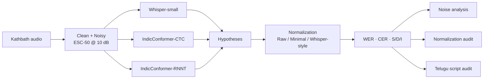

<div align="center">

# Beyond WER

### Diagnosing ASR Failure Patterns and Normalization Effects in Indian Languages

**Whisper-small vs. IndicConformer (CTC & RNNT) on Hindi, Tamil and Telugu**


*CSE413 – NLP Minor Project · IIIT Kottayam*

</div>

---

## 👥 Team

| Lalith Chaitanya  | 2023BCD0033 
| Manoj | 2023BCD0029 
| Sai Nihal | 2023BCD0045 

## 📌 At a Glance

| | |
|---|---|
| **Question** | Is WER alone enough to judge ASR quality for Indian languages? |
| **Systems** | Whisper-small · IndicConformer-CTC · IndicConformer-RNNT |
| **Data** | Kathbath (Hindi, Tamil, Telugu) · clean + noisy (ESC-50 noise, 10 dB SNR) |
| **Scale** | 3 languages × 2 conditions × 500 utterances × 3 systems = **9,000 predictions** |
| **Headline result** | IndicConformer-RNNT is best everywhere; Whisper-small fails on Telugu with **WER > 130%** because it mostly outputs the wrong script |
| **Key insight** | Text normalization alone can change reported WER by **tens of points** and destroys Indic combining marks |

---

## 1. 🎯 Project Aim

Standard ASR evaluation applies one normalization recipe and reports a single WER. For Indic scripts this can be misleading: normalizers may strip combining marks, change token boundaries, and hide serious failures such as wrong-script output.

**This project aims to:**

1. Compare Whisper-small and IndicConformer (CTC / RNNT) on Hindi, Tamil and Telugu.
2. Measure robustness to synthetic background noise.
3. Quantify how the choice of text normalization changes reported WER.
4. Diagnose *why* models fail, using error decomposition and script-level audits, not only aggregate scores.

---

## 2. 🔬 What We Did

| Step | Description |
|---|---|
| **Data** | 500 utterances per language and condition from **Kathbath**; noisy versions made by mixing **ESC-50** clips at 10 dB SNR |
| **Models** | Whisper-small, IndicConformer-CTC, IndicConformer-RNNT |
| **Metrics** | WER, CER, plus substitution / deletion / insertion counts |
| **Normalization study** | Raw vs. Minimal vs. Whisper-style (`BasicTextNormalizer`) |
| **Diagnostics** | Reference token-count and Unicode audit; Telugu output-script audit |

---

## 3. ⚙️ How We Did It



**Metrics.**
`WER = (S + D + I) / N` over words, `CER` the same over characters (whitespace excluded). WER can exceed 100% when insertions are many, and we do not clip it.

**Normalization.** The same normalizer is always applied to both reference and hypothesis.

| Method | What it does |
|---|---|
| Raw | Unicode NFC + whitespace cleanup |
| Minimal *(headline results)* | NFC + punctuation/symbols → spaces + whitespace cleanup |
| Whisper-style | Hugging Face Whisper `BasicTextNormalizer` |

---

## 4. 📊 Results

> All numbers below use **minimal normalization**, 500 utterances per cell, shown as **clean → noisy**.

### 4.1 Word Error Rate (%)

| Model | Hindi | Tamil | Telugu |
|---|:---:|:---:|:---:|
| **IndicConformer-RNNT** | **10.11 → 11.77** | **21.57 → 23.40** | **20.14 → 23.10** |
| IndicConformer-CTC | 10.86 → 12.64 | 22.81 → 24.58 | 21.77 → 24.16 |
| Whisper-small | 56.29 → 60.20 | 72.67 → 77.15 | 133.66 → 137.11 |

### 4.2 Character Error Rate (%)

| Model | Hindi | Tamil | Telugu |
|---|:---:|:---:|:---:|
| **IndicConformer-RNNT** | **3.02 → 3.84** | **3.39 → 4.04** | **3.48 → 4.53** |
| IndicConformer-CTC | 3.14 → 4.07 | 3.72 → 4.33 | 3.68 → 4.62 |
| Whisper-small | 24.09 → 27.53 | 20.94 → 25.90 | 112.19 → 113.58 |

### 4.3 Key Findings

1. **RNNT > CTC > Whisper-small.** IndicConformer-RNNT had the lowest WER in all 6 language–condition settings.
2. **Noise hurts everyone.** WER rose for every model–language pair: about **+1.7 to +3.0 points** for IndicConformer and **+3.4 to +4.5 points** for Whisper-small.
3. **Telugu breaks Whisper-small.** WER and CER exceed 100% in both clean and noisy audio, so noise is not the cause.
4. **Normalization changes the numbers dramatically** (Section 4.4).
5. **WER alone hides failure modes.** Script-level inspection explains what the score cannot (Section 4.5).

### 4.4 Normalization Effect

Whisper-style normalization drastically lowers WER, but only because it **rewrites the text**.

| Model (clean WER %) | Hindi | Tamil | Telugu |
|---|:---:|:---:|:---:|
| IndicConformer-RNNT, minimal | 10.11 | 21.57 | 20.14 |
| IndicConformer-RNNT, Whisper-style | 4.71 | 5.09 | 5.38 |
| Whisper-small, minimal | 56.29 | 72.67 | 133.66 |
| Whisper-small, Whisper-style | 35.95 | 31.16 | 123.12 |

**Why the numbers are not comparable.** The audit shows what Whisper-style normalization does to the *reference* transcripts:

| Language | Reference words (original → normalized) | Combining marks kept | Characters distorted |
|---|:---:|:---:|:---:|
| Hindi | 5,854 → 10,856 (1.9×) | 100% → **0%** | 0% → **32.0%** |
| Tamil | 5,317 → 18,473 (3.5×) | 100% → **0%** | 0% → **36.6%** |
| Telugu | 5,398 → 16,273 (3.0×) | 100% → **0%** | 0% → **38.4%** |

The normalizer removes all combining marks and splits words into many more tokens, so the WER denominator and the text itself change. **Takeaway:** a normalizer built for English is not script-safe for Indic languages, and the normalization method must always be reported with the score.

### 4.5 Telugu Whisper-small Failure Audit

We classified the Unicode script of every Telugu hypothesis (500 clean, 500 noisy).

| Output script | Clean | Noisy |
|---|:---:|:---:|
| Devanagari | 350 (70.0%) | 331 (66.2%) |
| Other scripts | 100 | 112 |
| Latin | 26 | 23 |
| No letters (symbols only) | 16 | 23 |
| Mixed scripts | 6 | 8 |
| **Telugu** | **2 (0.4%)** | **3 (0.6%)** |

Whisper-small produced Telugu script in **under 1% of utterances**. Most output was Devanagari, so the error is a *script-generation* failure rather than ordinary misrecognition. The audit does not identify the root cause (language ID, decoding behavior, or model limits remain open).

---

## 5. ✅ Conclusions

- **IndicConformer-RNNT** is the most accurate and most robust system tested.
- **Whisper-small** is far weaker on these Indian languages and unusable for Telugu in this setup.
- **Normalization is part of the methodology**, not a neutral preprocessing step: it changes scores by large margins and can distort Indic text.
- **Aggregate metrics must be paired with diagnostics** such as error decomposition and script audits.

---

## 6. ⚠️ Limitations

- Only three languages and a 500-utterance subset per condition; clean and noisy sets share the same underlying utterances.
- One synthetic noise type and SNR (ESC-50, 10 dB); no real-world noise.
- Results are descriptive; no confidence intervals or significance tests yet.
- Telugu failure cause is not established.

**Future work:** more languages and SNR levels, significance testing, language-aware normalizers that preserve Indic combining marks, and root-cause analysis of the Telugu failure.

---

## 7. 🚀 Quick Start

```bash
git clone <repo-url> && cd asr-normalization-project
python -m venv .venv && source .venv/bin/activate     # Windows: .\.venv\Scripts\Activate.ps1
pip install -r requirements.txt

python scripts/run_inference.py --manifest data/manifest_validated.parquet \
  --output-dir artifacts/predictions \
  --models whisper indicconformer_ctc indicconformer_rnnt \
  --languages hi ta te --conditions clean noisy

python scripts/evaluate.py      # WER / CER under each normalizer
python scripts/run_analysis.py  # S/D/I, normalization audit, Telugu audit
pytest -q
```

> Check each script's `--help`: the exact arguments depend on your final implementation. Audio data and model checkpoints are not stored in the repo; obtain **Kathbath** and **ESC-50** separately under their licenses.

<details>
<summary><b>Repository layout</b></summary>

```text
├── configs/        experiment configuration
├── src/
│   ├── data/       dataset prep, audio utilities
│   ├── models/     Whisper and IndicConformer wrappers
│   ├── evaluation/ normalization, metrics, error + script audits
│   └── visualization/
├── scripts/        prepare_data · run_inference · evaluate · run_analysis
├── tests/          unit and data-integrity tests
├── notebooks/      exploration and analysis
└── artifacts/      predictions, metrics, figures, logs
```
</details>

---

## 8. 📚 References

1. Radford et al., *Robust Speech Recognition via Large-Scale Weak Supervision (Whisper)*. https://arxiv.org/abs/2212.04356
2. AI4Bharat, *IndicConformer*. https://huggingface.co/ai4bharat/indic-conformer-600m-multilingual
3. AI4Bharat, *Kathbath dataset*. https://github.com/AI4Bharat/IndicWav2Vec
4. Piczak, *ESC-50: Dataset for Environmental Sound Classification*. https://github.com/karolpiczak/ESC-50
5. *JiWER* (WER/CER toolkit). https://github.com/jitsi/jiwer

<div align="center">

**Beyond WER: toward reliable, language-aware ASR evaluation**

</div>
